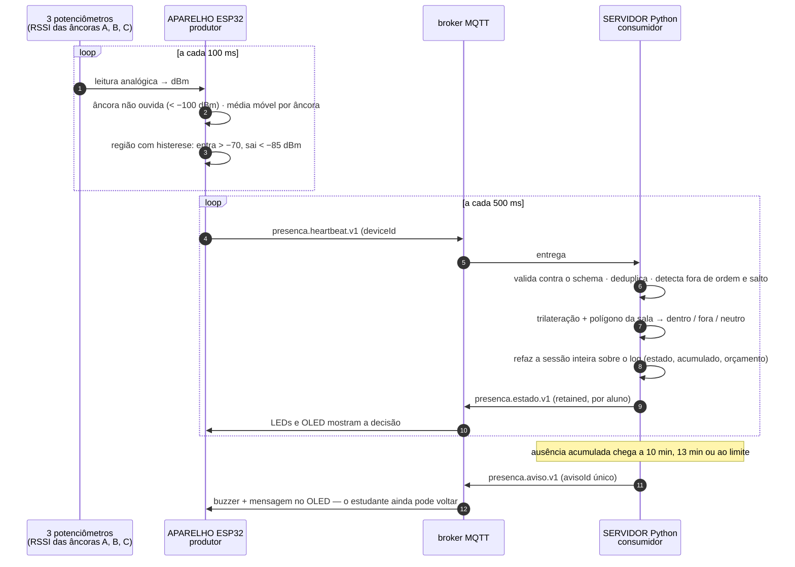

# Marco 2 — fronteira de comunicação aparelho ↔ servidor

Integração real entre dois componentes do sistema **Presença**. O **aparelho do
estudante** (ESP32 no Wokwi) mede o sinal das três âncoras da sala e envia heartbeats;
o **servidor de permanência** (Python) localiza, decide o estado, acumula o tempo e
**devolve** ao aparelho o estado e os avisos que fecham o laço ciber-físico.

É o núcleo do projeto: **permanência medida, não presença num instante**.

| | |
|---|---|
| **Produtor** | Aparelho do estudante — ESP32 no Wokwi ([`aparelho/`](aparelho/)) |
| **Comunicação** | MQTT sobre TCP, broker público `broker.hivemq.com:1883` |
| **Consumidor** | Servidor de permanência — Python ([`servidor/`](servidor/)) |
| **Contrato** | [`contrato/v1/`](contrato/v1/) — `presenca.heartbeat.v1`, `presenca.estado.v1`, `presenca.aviso.v1` |
| **Evidências** | [`evidencias/presenca/`](evidencias/presenca/) — capturas e logs de uma sessão completa |

Uma segunda fronteira, já pronta e anterior a esta, fica em [`co2-ancora/`](co2-ancora/) e
[`co2-gateway/`](co2-gateway/): a âncora confere a contagem do rádio contra o CO₂ da sala,
a defesa contra o conluio em massa. Ela é descrita no [`GUIA.md`](GUIA.md).

> A apresentação completa, com fotos, testes e resultados, está em
> [`apresentacao/apresentacao-marco-02.pdf`](apresentacao/apresentacao-marco-02.pdf).

---

## 1. O que atravessa a fronteira



## 2. Quem decide o quê

| Componente | Faz | Não faz |
|---|---|---|
| **Aparelho (ESP32)** | Lê o RSSI de cada âncora, trata âncora não ouvida, filtra, decide a **região de rádio** com histerese, envia heartbeat com sequência, retém heartbeats quando a rede cai, mostra o estado e toca o aviso | Não sabe onde fica a sala, não decide presença, não guarda acumulado |
| **Servidor (Python)** | Valida o contrato, deduplica, localiza por **trilateração**, testa o **polígono**, aplica **persistência**, roda a máquina de estados, recalcula o acumulado sobre o log, controla o **orçamento por sessão** e a **requalificação**, emite os avisos | Não mede sinal |

A histerese −70/−85 dBm fica no aparelho porque é o que o iOS faz no monitoramento de
região: o sistema operacional decide entrada e saída e acorda o aplicativo. O polígono
fica no servidor porque só ele conhece a planta da sala. É por isso que um sinal forte
vindo da sala vizinha passa pela histerese mas **não** pelo polígono.

## 3. Os tempos comprimidos

Todos os parâmetros estão no código com os valores reais do projeto e são divididos por
uma **escala** (`servidor/config.exemplo.json`, padrão 30). É o que o §12 do projeto técnico
manda fazer: o relógio do Wokwi não anda em tempo real.

| Parâmetro | Projeto | Demonstração (÷30) |
|---|---|---|
| Persistência de entrada e saída | 30 s | 1 s |
| Orçamento de ausência por sessão | 15 min | 30 s |
| Avisos | 10 min e 13 min | 20 s e 26 s |
| Requalificação no retorno | min(30 min, restante) | min(60 s, restante) |
| Aula | 50 min | 100 s |
| Presença mínima | 75 % | 75 % |
| Heartbeat | 60–90 s | 500 ms (mais denso que a escala, para a demonstração ficar fluida) |

## 4. A regra, em poucas linhas

- Cada heartbeat vira **dentro**, **fora** ou **neutro**:
  região `FORA_ALCANCE` → fora; `DENTRO_ALCANCE` e ponto no polígono → dentro;
  `DENTRO_ALCANCE` e ponto fora do polígono → fora; faltando âncora → neutro.
- A condição tem de se **sustentar** pela persistência. Neutro interrompe a contagem.
- A entrada e a saída valem **desde o início real** da condição, e não desde o momento em
  que ela foi confirmada. Por isso o acumulado é calculado sobre o log inteiro.
- `PRESENTE → AUSENCIA_TOLERADA` enquanto houver orçamento. Se o estudante voltar a
  tempo, a ausência só é creditada depois que ele **permanecer** o tempo de
  requalificação. Aparecer por instantes não reabre crédito.
- Se o orçamento acabar, vai para `FORA` e a ausência inteira é **estornada**. O aviso diz
  a hora em que o tempo parou de contar.
- O acumulado garantido **nunca diminui**. O que ainda pode mudar aparece em separado,
  como `provisorio`.

Tudo isso está em [`servidor/permanencia.py`](servidor/permanencia.py), um módulo sem
rede e sem relógio, exercitado por 23 testes (e o servidor, por outros 11).

## 5. Condições de falha exercitadas

### Botão azul — anomalia de sequência (teste adversarial, matrícula final 8)

Cada aperto arma a próxima anomalia, em ciclo:

| Anomalia | O que o aparelho faz | O que o servidor faz |
|---|---|---|
| **Duplicata** | Reenvia o último heartbeat, byte a byte | `eventId` já visto → descarta, nada recalculado |
| **Fora de ordem** | Segura o heartbeat N e o entrega depois do N+1 | Aceita e **insere na posição original** da linha do tempo; o resultado é idêntico ao da chegada em ordem. Se o N+1 tinha aberto uma lacuna, ela é fechada: não estava perdido, só atrasado |
| **Salto** | Pula 5 números de sequência | Registra 5 perdidos; o intervalo fica sem evidência |

O servidor **não lê** o campo `anomaliaInjetada`: detecta tudo pela sequência.

O `bootId` na chave resolve um problema que só aparece rodando: sem ele, reiniciar a
simulação zera a sequência e **todo** heartbeat do boot novo parece cópia.

### Botão vermelho — queda de rede

O aparelho continua medindo e retém até 60 heartbeats (30 s) com o `eventTimeMs`
original. O servidor acusa **SILÊNCIO** e não decide nada sem dado. Quando a rede volta,
os retidos chegam com `bufferizado: true`, entram **no passado** e a sessão é refeita.
Durante a queda, os LEDs de estado se **apagam**: uma resposta expirada não continua acesa
como se fosse atual.

## 6. Como executar

### Servidor (local)

```bash
cd marco-02/servidor
pip install -r requirements.txt
python servidor.py          # usa config.json, ou config.exemplo.json
python -m pytest testes -q  # 34 testes
```

Teclas: `n` aula nova · `p` resumo · `q` sair (sempre com Enter). O quadro de resumo também
aparece sozinho a cada 24 mensagens recebidas (`painel_a_cada` no config; 0 desliga). As mensagens da tela são em português simples, para a banca acompanhar.

**Rede que bloqueia a porta 1883** (a da faculdade): `python servidor.py --ws`. O servidor
passa a falar MQTT dentro de um WebSocket seguro (`wss://broker.hivemq.com:8884/mqtt`), que
atravessa firewalls que só deixam passar tráfego parecido com o da web. O ESP32 não muda: ele
roda na nuvem do Wokwi e continua na 1883; o broker entrega as mensagens entre os dois
transportes. Verificado em 25/09/2026: servidor em WebSocket e aparelho em TCP trocando
heartbeats e estados. Também vale para o gateway de CO₂: `python consumidor.py --ws`.

### Aparelho (Wokwi)

1. Abra https://wokwi.com/projects/476110187626906625 — ou crie um projeto ESP32 e
   cole [`aparelho/sketch.ino`](aparelho/sketch.ino) e [`aparelho/diagram.json`](aparelho/diagram.json).
   Bibliotecas: `PubSubClient`, `Adafruit GFX Library`, `Adafruit SSD1306`.
2. Rode. Os potenciômetros já começam no centro da sala.
3. **Mantenha a janela do Wokwi visível.** Com a janela oculta, o navegador congela a
   simulação — o relógio para.

### Como posicionar os potenciômetros com exatidão

Clique no potenciômetro e use o teclado: **Home** leva a 0, **End** a 1023, **PageUp/PageDown**
somam/subtraem 102 e as **setas** ajustam de 1 em 1. O OLED mostra o RSSI resultante.
Reiniciar a simulação **não** devolve os potenciômetros à posição inicial; recarregar a página devolve.

| Cenário | A | B | C | RSSI (A, B, C) | Resultado |
|---|---|---|---|---|---|
| Dentro da sala (posição inicial) | Home + 7×PgUp | Home + 7×PgUp | Home + 7×PgUp | −56, −56, −56 | (6,0; 2,8), dentro |
| Corredor, junto à sala | Home + 5×PgUp | Home + 8×PgUp | Home + 7×PgUp | −70, −49, −56 | (13,9; 12,4): sinal forte, **fora** do polígono |
| Fora do prédio | Home | Home | Home | nenhuma ouvida | fora |

## 7. O que foi validado e o que não foi

| Validado no simulador | Exigiria hardware e ambiente reais |
|---|---|
| Contrato, sequência, deduplicação, fora de ordem, salto, silêncio | Propagação de rádio real: multipercurso, corpo humano, parede |
| Histerese de região, trilateração, polígono, persistência | Calibração dos limiares em dBm por levantamento na sala |
| Orçamento, requalificação, estorno, avisos no momento certo | Cadência real de heartbeat no Android e eventos de região no iOS |
| Retenção local e reentrega com recálculo retroativo | Fila sobrevivendo a reinício do aparelho (aqui é volátil) |

**Os potenciômetros não são rádio.** Não houve aquisição nem validação de RSSI real: o
Wokwi não simula propagação, não há BLE, distância nem parede. São fontes de valor
controláveis entre −105 e −35 dBm.

**Fora do escopo deste marco:** token rotativo da âncora, assinatura do heartbeat,
pareamento por QR, variância de IMU e `PAUSA_PROGRAMADA` (o estado está no contrato,
mas a agenda não está implementada).
