# Marco 3 — Segurança

O protótipo com rádio de verdade (notebook como âncora Bluetooth, celular do estudante medindo
o sinal, servidor de permanência) passou a ser o sistema oficial, a pedido do professor. O
Marco 3 coloca nele **segurança de ponta a ponta**.

> **Material de apoio:** slides em [`apresentacao/Marco3-Slides.pdf`](apresentacao/Marco3-Slides.pdf) ·
> explicação completa com prints e trechos de código em
> [`documentacao/Marco3-Seguranca.pdf`](documentacao/Marco3-Seguranca.pdf) ·
> roteiro da demonstração em [`GUIA.md`](GUIA.md).

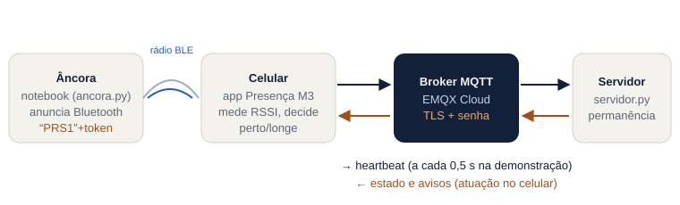

## A entrega do Marco 3

O que foi pedido em aula, e onde está cada resposta:

| # | Pedido | Resposta curta | Situação |
|---|---|---|---|
| 1 | [**Segurança**](#1-segurança) (tema principal) | quatro camadas, cada ataque testado e recusado | feito |
| 2 | [**Canal criptografado**](#2-canal-criptografado) | TLS obrigatório: o broker só atende as portas 8883 e 8084 | feito e testado |
| 3 | [**Autenticação MQTT**](#3-autenticação-mqtt) | um usuário e senha por papel no broker EMQX Cloud | feito e testado |
| 4 | [**Todo dispositivo tem que falar quem é**](#4-todo-dispositivo-tem-que-falar-quem-é) | toda mensagem assinada (Ed25519) por quem a produziu; a âncora prova com token HMAC | feito e testado |
| 5 | [**Fazer atuação e autenticação**](#5-fazer-atuação-e-autenticação) | o servidor responde assinado e o celular atua (vibra, notifica) só com mensagem autêntica | feito e testado |
| 6 | [**Processo inverso**: produtor do lado do consumidor e consumidor do lado do produtor](#6-processo-inverso-produtor--consumidor) | celular e servidor produzem e consomem; os dois assinam e conferem | feito |
| 7 | [**Fazer funcionar redes de sensores**](#7-fazer-funcionar-redes-de-sensores) | âncora + celulares + servidor funcionando ponta a ponta | 1 âncora física |

---

### 1. Segurança

Antes de proteger, o que pode dar errado — quatro jeitos de enganar o sistema, cada um
respondido por uma camada:

| Ataque | Camada que impede | Como |
|---|---|---|
| **ler** as mensagens no caminho (Wi-Fi da faculdade) | TLS | broker só com portas cifradas |
| **entrar** no broker sem ser do sistema | autenticação MQTT | usuário e senha por papel |
| **falar em nome de outro** (aluno, servidor, admin) | assinatura por dispositivo | envelope assinado em toda mensagem |
| dizer que **está na sala estando em casa** | token da âncora | token HMAC que só vale na janela de 12 s atual |

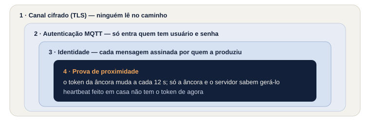

A camada de assinatura é necessária mesmo com senha porque a senha do app vai **dentro do APK**:
todo celular conecta com ela, e quem descompilar o APK a obtém. A senha separa "de dentro" de
"de fora"; a assinatura separa um estudante do outro.

**O problema, rodando** — o broker público usado até o Marco 2 (`broker.hivemq.com`), sem senha:

```text
$ python ataques.py publico --ws
══ 1. Broker PÚBLICO (broker.hivemq.com) — como era até o Marco 2 ══
  atacante tenta: conectar em broker.hivemq.com:8884 SEM usuário e SEM senha
  CONSEGUIU — conectado
  atacante tenta: assinar ufg/ssu/presenca/# e PUBLICAR um heartbeat falso lá dentro, sem senha
  CONSEGUIU — publicou em ufg/ssu/presenca/alany/proto1/sala-pc/heartbeat e o broker entregou de volta: escrever e ler, sem senha
```

**Por que EMQX e não HiveMQ:** o professor indicou o HiveMQ. O broker público dele é justamente o
problema acima, e o HiveMQ Cloud deixou de ter plano gratuito (pede cartão; ~US$ 249/mês depois de
15 dias). O **EMQX Cloud Serverless** tem TLS obrigatório, usuário/senha e ACL por tópico de graça,
sem cartão, com limite de gasto US$ 0 (suspende em vez de cobrar). O protocolo é o mesmo
(MQTT 3.1.1): mudou só endereço e porta.

| | HiveMQ público | HiveMQ Cloud | EMQX Cloud Serverless |
|---|---|---|---|
| Senha | nenhuma | sim | sim, por usuário |
| Só TLS | não (1883 aberta) | sim | sim (8883 e 8084) |
| Tópico por usuário (ACL) | não | só no pago | sim |
| Custo | grátis | cartão, ~US$ 249/mês após 15 dias | grátis, sem cartão |

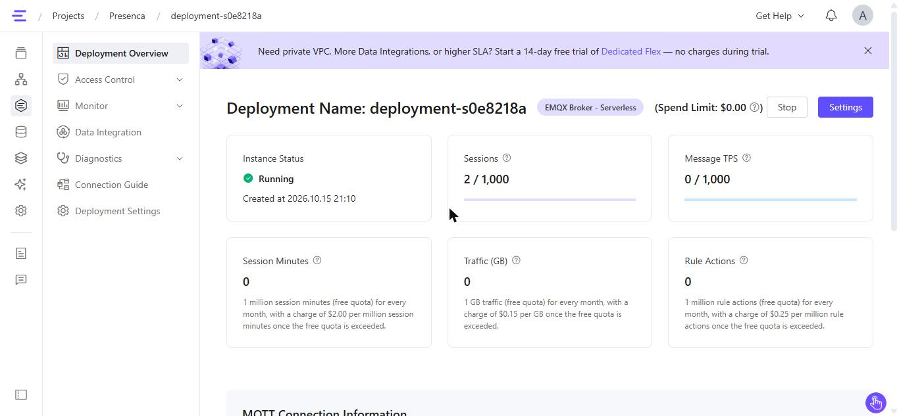

---

### 2. Canal criptografado

**TLS** (o mesmo cadeado do HTTPS) faz duas coisas: **cifra** tudo — quem está no Wi-Fi vê só bytes
embaralhados, nem a senha aparece — e **prova que o broker é o broker**, pelo certificado.

- O EMQX Cloud Serverless só aceita conexão cifrada: **8883** (MQTT sobre TLS) e **8084** (MQTT
  sobre WebSocket com TLS, `wss://`). As portas abertas (1883, 8083) não existem.
- Servidor: `cliente.tls_set()` em [`servidor/servidor.py`](servidor/servidor.py) → `criar_cliente()`.
  O certificado é conferido e não há caminho sem TLS.
- App: `wss://…:8084/mqtt` com `useSSL: true` em [`app/src/lib/mqtt.ts`](app/src/lib/mqtt.ts).

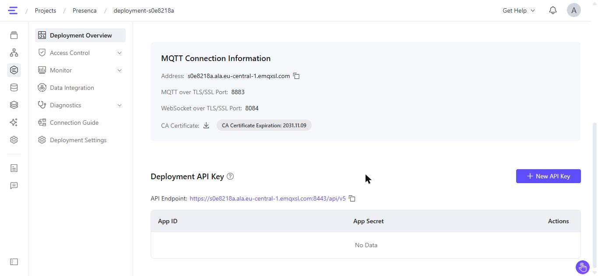

**Prova** (primeira tentativa abaixo): a porta sem cifra nem abre.

---

### 3. Autenticação MQTT

Dois usuários no broker (*Access Control → Authentication*), **um por papel**. As senhas são
aleatórias de 20 caracteres e ficam só em `segredos.json` (fora do git).

| Usuário | Quem usa | Onde a senha fica |
|---|---|---|
| `presenca-servidor` | o servidor | `segredos.json`, no notebook |
| `presenca-app` | todos os celulares | `segredos.json` → `app/src/lib/segredos.ts` → dentro do APK |

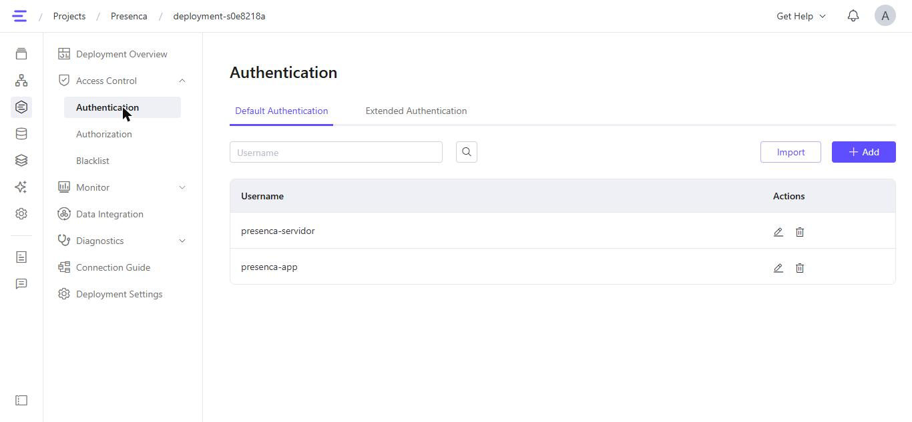

Durante o ensaio, cada conexão aparece no broker com o seu usuário (IP oculto):

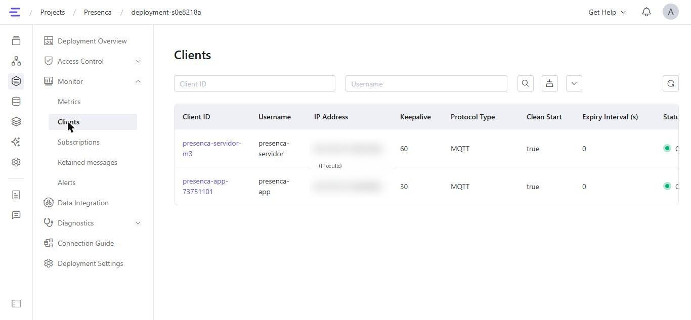

No código: `username_pw_set()` no servidor e `userName`/`password` no app. Se a senha estiver
errada, o servidor avisa *"O broker RECUSOU a conexão"* em vez de ficar tentando em silêncio.

**Prova — o intruso tenta entrar no EMQX** (saída real):

```text
$ python ataques.py senha
══ 2. EMQX Cloud — sem TLS, sem senha, senha errada ══
  atacante tenta: MQTT aberto, sem TLS, em s0e8218a.ala.eu-central-1.emqxsl.com:1883
  BLOQUEADO — a conexão nem abriu (TimeoutError)
  atacante tenta: TLS na porta 8883, mas SEM usuário e senha
  BLOQUEADO — o broker recusou: Bad user name or password
  atacante tenta: TLS com o usuário presenca-app e senha ERRADA
  BLOQUEADO — o broker recusou: Bad user name or password
  atacante tenta: TLS com usuário e senha certos (para comparar)
  CONECTOU — conectado
```

Testado também pela porta 8084 (WebSocket), com o mesmo resultado.

---

### 4. Todo dispositivo tem que falar quem é

Cada dispositivo tem um **par de chaves Ed25519** ([RFC 8032](https://www.rfc-editor.org/rfc/rfc8032)):
a **privada** nunca sai dele e assina, como um carimbo que só o dono tem; a **pública** vai junto da
mensagem e qualquer um confere. Mudou um byte da mensagem, a assinatura não confere mais.

**O nome do aluno sai da própria chave.** O pseudônimo é o início do SHA-256 da chave pública:

```text
chave pública d04ab232…c9778737  ──SHA-256──▶  aluno: tok-10ba682c · aparelho: cel-8ad1
```

Não precisa de cadastro (o servidor recalcula o hash da chave que veio na mensagem), ninguém assina
como `tok-10ba682c` sem a chave privada dele, e nada de MAC, IMEI ou nome.

**Toda mensagem viaja num envelope assinado** (contrato
[`seguranca.envelope.v1`](contrato/v1/seguranca.envelope.v1.schema.json)). A assinatura cobre **o
tópico MQTT + a carga**: uma mensagem válida não pode ser levada para o tópico de outro aluno.

```json
{
  "eventType": "seguranca.envelope.v1",
  "de": "tok-10ba682c",
  "chavePublica": "d04ab232…8737",
  "carga": "{\"eventType\":\"presenca.heartbeat.v2\", …}",
  "assinatura": "d102ad2b…a405"
}
```

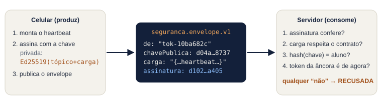

**O servidor passa cada heartbeat por quatro portas** ([`servidor.py`](servidor/servidor.py) →
`_conferir()`) antes de contar um segundo de presença:

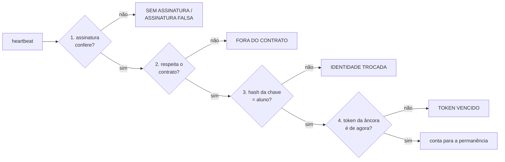

**A âncora também diz quem é.** O token que ela anuncia por Bluetooth não é mais sorteado:

```text
token = HMAC-SHA256( segredo da âncora , "anc-pc-1|" + ⌊hora ÷ 12 s⌋ )[0..3]
anúncio Bluetooth:  "PRS1" | 01 | token (4 bytes)      — empresa 0xFFFF (reservada para testes)
```

Só a âncora e o servidor têm o segredo; os dois usam o mesmo relógio, então calculam o mesmo token
sem conversar. O celular só **repassa** o que ouviu (campo `ancoras[].token` do contrato
[`presenca.heartbeat.v2`](contrato/v1/presenca.heartbeat.v2.schema.json)) — não consegue inventar.
Heartbeat feito em casa não tem o token de agora; um capturado e repetido depois já venceu.

```text
$ python ancora.py
══ Presença · Marco 3 · âncora (este notebook) ══
Anunciando por Bluetooth como anc-pc-1. Token novo a cada 12 s, assinado com o segredo da âncora (HMAC).

02:41:05  janela 149344105  token 45cb0d0e
           rádio: TRANSMITINDO
02:41:12  janela 149344106  token 42f6d47b
02:41:24  janela 149344107  token bf18fee7
```

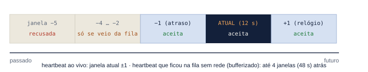

**Os quatro dispositivos e a prova de cada um:**

| Dispositivo | Como prova quem é | Quem confere | Se falhar |
|---|---|---|---|
| **Celular do estudante** | assina cada heartbeat; o nome é o hash da chave | servidor | `SEM ASSINATURA`, `ASSINATURA FALSA`, `IDENTIDADE TROCADA` |
| **Âncora** | token HMAC que só ela e o servidor sabem gerar | servidor | `TOKEN VENCIDO` |
| **Servidor** | assina estado e avisos; a chave pública dele vem fixada no app | celular | mensagem ignorada e contada como falsa |
| **Celular do administrador** | assina a turma (grade e limiar de 1 m); o aluno guarda a chave no pareamento | celular do estudante | *"Turma recusada"* |

**Prova — com a senha do app vazada, três falsificações e três recusas.** O atacante
(`python ataques.py forjar`) tenta: (a) heartbeat sem assinatura; (b) assinado com a chave dele,
dizendo ser outro aluno; (c) assinado como ele mesmo, de casa, com token inventado. O servidor,
conectado ao EMQX real, imprimiu:

```text
$ python servidor.py
Conectado ao s0e8218a.ala.eu-central-1.emqxsl.com, porta 8084 (MQTT sobre WebSocket com TLS, usuário presenca-servidor).
  x RECUSADA      SEM ASSINATURA — mensagem fora do envelope assinado
  x RECUSADA      IDENTIDADE TROCADA — assinou com a chave de tok-4481657a, mas diz ser tok-12345678
  x RECUSADA      TOKEN VENCIDO — o token 1a2b3c4d não é o que a anc-pc-1 anuncia agora (heartbeat inventado ou requentado)
```

Código: [`servidor/seguranca.py`](servidor/seguranca.py),
[`app/src/lib/assinatura.ts`](app/src/lib/assinatura.ts),
[`app/src/lib/identidade.ts`](app/src/lib/identidade.ts), [`ancora/ancora.py`](ancora/ancora.py).

---

### 5. Fazer atuação e autenticação

O servidor responde a cada heartbeat com o **estado** (e, nos momentos certos, um **aviso**), ambos
**assinados** com a chave dele. O celular só aceita o que vier assinado pela chave do servidor fixada
no app e, então, **atua**: vibra, mostra notificação e o aviso na tela ("notificar antes de punir").
A turma enviada pelo administrador também só é aceita com a assinatura dele.

- Confere: [`app/src/lib/usar-aparelho.ts`](app/src/lib/usar-aparelho.ts) (estado e aviso) e
  [`app/src/lib/rede-turma.ts`](app/src/lib/rede-turma.ts) (turma).
- Atua: [`app/src/app/turma/[codigo].tsx`](app/src/app/turma/%5Bcodigo%5D.tsx) → `aoAviso`
  (vibração, notificação, cartão na tela).

**Prova:**

| Ataque | O que o atacante manda | O que aparece no celular (cartão **Segurança**) |
|---|---|---|
| `python ataques.py estado` | "PRESENTE, 100 %" no tópico do aluno, sem assinatura e com a chave do atacante | *Recusei 2 mensagem(ns) falsa(s)* — a tela não muda |
| `python ataques.py turma` | turma com limiar de 1 m em −100 dBm (todo mundo pareceria perto, até de casa) | *Turma recusada: turma assinada por outro administrador* |

---

### 6. Processo inverso: produtor ↔ consumidor

Num IoT simples o sensor só produz e o servidor só consome. Aqui **os dois lados fazem os dois
papéis**, e a autenticação vale **nos dois sentidos**: quem produz assina, quem consome confere.

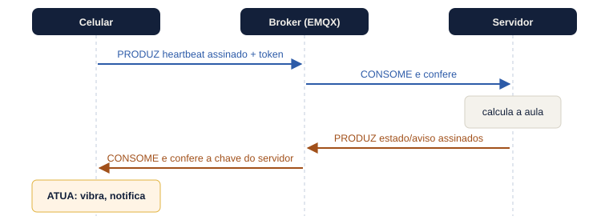

| | Produz | Consome |
|---|---|---|
| **Celular** | heartbeat (assinado, com o token da âncora) | estado e avisos (confere a assinatura do servidor) |
| **Servidor** | estado e avisos (assinados) | heartbeat (confere assinatura, identidade e token) |

O laço fecha com a atuação no celular (item 5).

---

### 7. Fazer funcionar redes de sensores

Os nós da rede são as **âncoras** (faróis fixos) e os **celulares** (os sensores de verdade: cada um
mede o sinal com o próprio rádio). O servidor junta as medições, com uma sessão por estudante.

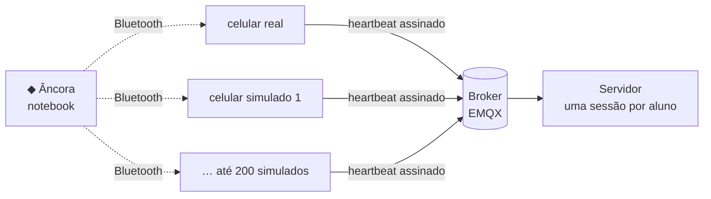

- **Funcionando:** 1 âncora real (o notebook), o celular real e celulares simulados
  ([`ataques/carga.py`](ataques/carga.py)), cada um com a própria chave e assinando de verdade.
- **Pronto para mais:** o heartbeat leva até 3 âncoras, cada uma com o seu token; o servidor confere
  cada token contra o segredo daquela âncora (`segredos.json` → `ancoras`).
- **Falta:** 3 âncoras físicas e a malha ESP-NOW entre elas.

**Testes automáticos** cobrindo a segurança (todos passando — 49 no servidor, 22 no app):

```text
$ python -m pytest testes -v -k "segurança"
test_heartbeat_de_exemplo_respeita_o_contrato PASSED
test_campo_desconhecido_e_rejeitado_pelo_contrato PASSED
test_mensagem_sem_assinatura_e_recusada PASSED
test_carga_alterada_depois_de_assinada_e_recusada PASSED
test_assinatura_de_outro_topico_e_recusada PASSED
test_falar_em_nome_de_outro_aluno_e_recusado PASSED
test_token_de_outra_janela_e_recusado PASSED
test_token_inventado_e_recusado PASSED
test_heartbeat_da_fila_aceita_token_de_ate_48_s PASSED
test_ancora_nao_ouvida_nao_precisa_de_token PASSED
test_respostas_saem_assinadas_pelo_servidor PASSED
```

No app, [`assinatura.test.ts`](app/src/lib/assinatura.test.ts) garante que o JavaScript e o Python
calculam **o mesmo pseudônimo** para a mesma chave e que mensagem alterada, de outro tópico ou com
chave que não é a do servidor é recusada.

---

## Além da entrega

### Quantos dispositivos uma âncora monitora?

**A âncora não monitora ninguém: ela só transmite** (é um farol). Um anúncio Bluetooth é ouvido por
todos os celulares em volta ao mesmo tempo — **não há limite de celulares por âncora**. O limite
está no caminho de volta, e foi medido com o broker real (cada celular simulado com a própria chave,
heartbeat a cada 0,5 s):

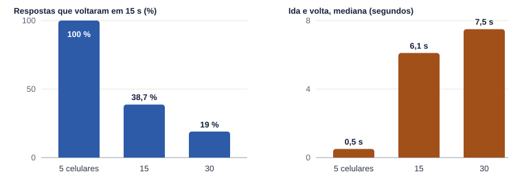

```text
$ python carga.py 5 --tempo 15
══ Resultado: 5 celulares ══
  heartbeats enviados:  155  (10 por segundo)
  estados de volta:     155  (100.0 %)
  ida e volta (celular → broker → servidor → broker → celular):
     mediana 502 ms · 95 % abaixo de 1156 ms · pior 1297 ms

$ python carga.py 200 --tempo 20 --sem-rede
══ Servidor sem rede: 200 celulares × 40 heartbeats (20 s de aula) ══
  por mensagem (abre envelope, confere assinatura e token, recalcula a aula, assina a resposta):
     média 0.42 ms · 95 % abaixo de 0.62 ms
  ≈ 2405 mensagens por segundo num núcleo deste notebook

$ python sonda.py      (um cliente publica 60 msg/s, outro conta; sem servidor no meio)
enviadas 600 (60/s) · recebidas 157 · nos 10 s: 10.7/s
```

| Medida | Resultado |
|---|---|
| Celulares por âncora | **sem limite** (farol) |
| Servidor sozinho | 0,4 ms por mensagem ≈ **2.400 msg/s** |
| Broker EMQX gratuito | **~11 msg/s por conexão** — é o gargalo (o servidor usa uma conexão) |
| Aula real (heartbeat a cada 60 s) | ≈ **650 celulares** por conexão do servidor (11 × 60) |

**Se precisar de mais:** várias cópias do servidor dividindo os heartbeats por
[assinatura compartilhada do MQTT](https://docs.emqx.com/en/emqx/latest/messaging/mqtt-shared-subscription.html)
(`$share/servidores/…/heartbeat`), cada uma com a sua conexão, ou o plano dedicado do broker.

### Dá para fazer com Arduino?

Sim: [`esp32-ancora/esp32-ancora.ino`](esp32-ancora/esp32-ancora.ino) é a mesma âncora para ESP32
(Arduino, núcleo Espressif 3.x): mesmo anúncio `PRS1 | nº | token`, mesmo token HMAC (mbedtls), hora
por NTP. Tem também um modo escuta (`MODO_ESCUTA = true`) que conta os aparelhos em volta.
**Não foi gravado em placa** (não havia ESP32 disponível); nos testes, o notebook faz o papel dele.

### Validações: distância do celular e quantos aparelhos por rádio

- [`ancora/escutar.py`](ancora/escutar.py) (notebook) e o modo escuta do ESP32 contam os aparelhos
  Bluetooth em volta e estimam a distância de cada um. Para o celular aparecer, ele precisa anunciar
  (app nRF Connect → Advertiser). Não é usado no sistema: a âncora passaria a saber quem está perto.
- Distância pelo modelo [log-distância](https://en.wikipedia.org/wiki/Log-distance_path_loss_model):
  `d = 10^((RSSI(1 m) − RSSI) / (10·n))`, com RSSI a 1 m medido na calibração do admin e n = 2,2
  estimado. Medição real pendente: preencher [`medicoes/distancia.csv`](medicoes/distancia.csv) e
  rodar `python medicoes/ajustar_distancia.py`.

---

## Estrutura

```
marco-03/
├── ancora/          ancora.py (âncora com token HMAC) · escutar.py (medição)
├── app/             app "Presença M3" (React Native/Expo) — ver app/README.md
├── servidor/        servidor.py · seguranca.py · permanencia.py · testes/
├── contrato/v1/     JSON Schemas, incluindo presenca.heartbeat.v2 e seguranca.envelope.v1
├── ataques/         ataques.py (demonstração dos ataques) · carga.py (teste de carga)
├── esp32-ancora/    a mesma âncora em Arduino (ESP32)
├── medicoes/        distancia.csv · ajustar_distancia.py
├── documentacao/    Marco3-Seguranca.pdf, figuras, prints e saídas capturadas
├── apresentacao/    Marco3-Slides.pdf
├── GUIA.md          roteiro da apresentação, comando por comando
├── configurar.py    gera os segredos locais
├── segredos.exemplo.json
└── gerar-apk.ps1
```

## Como rodar

### Uma vez: broker e segredos

1. Em https://cloud-intl.emqx.com: **EMQX Broker → New → Serverless**, limite de gasto US$ 0 →
   copie o **Address**. Em **Access Control → Authentication**, crie `presenca-servidor` e
   `presenca-app`.
2. No terminal (PowerShell), dentro de `marco-03`:

```powershell
pip install -r servidor\requirements.txt -r ancora\requirements.txt
python configurar.py     # cria segredos.json; preencha endereço e senhas
python configurar.py     # gera o segredo da âncora, a chave do servidor e app\src\lib\segredos.ts
cd app ; npm install --legacy-peer-deps ; cd ..
powershell -ExecutionPolicy Bypass -File .\gerar-apk.ps1     # gera presenca-m3.apk
```

`segredos.json`, a chave do servidor, `segredos.ts` e o APK **não vão para o git**.

### Cada vez

| Janela | Comando | Deve aparecer |
|---|---|---|
| 1 · âncora (Bluetooth ligado) | `cd ancora` → `python ancora.py` | `rádio: TRANSMITINDO` e um token a cada 12 s |
| 2 · servidor | `cd servidor` → `python servidor.py` | `Conectado ao …emqxsl.com, porta 8084` |
| celular | app **Presença M3**: admin publica a turma, calibra a 1 m, inicia a aula; o aluno entra pelo código | cartão **Segurança** com o pseudônimo |
| 3 · ataques | `cd ataques` → `python ataques.py senha \| forjar \| estado \| turma \| publico --ws` | recusas no servidor ou no celular |

`python servidor/testar_rede.py` diz se a rede alcança o broker. Rede que bloqueia as portas
8883/8084: use o hotspot do celular.

## Limites declarados

- A chave do celular fica no armazenamento seguro do Android (cifrado pelo Keystore), não dentro
  do chip: um celular com root a extrai.
- A senha do app está no APK: quem a extrai publica mensagens (recusadas) e lê pseudônimos.
  Próximo passo: ACL por tópico no EMQX.
- Alguém na sala retransmitindo o token ao vivo para quem está em casa (relay) continua possível.
- O primeiro pareamento confia na turma que chegar (é o momento do QR, uma vez).
- Âncora e servidor precisam de relógio certo (aqui são o mesmo notebook; no ESP32, NTP).

## Testes

```powershell
cd servidor ; python -m pytest testes -q     # 49 testes
cd ..\app ; npm test                          # 22 testes
```
